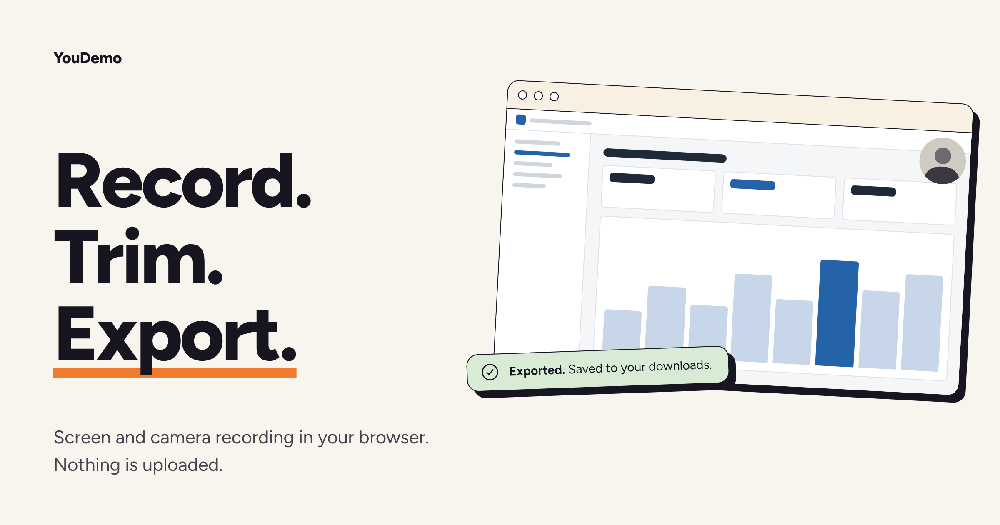

# YouDemo



A browser-only screen and webcam recorder for making quick, personal demo videos
— no installation, no subscription, no backend. Just open it and record.

Try [YouDemo](https://mjakinowittering.github.io/youdemo/) now!

---

## Features

- **Screen capture** — record any tab, window, or screen
- **Webcam overlay** — picture-in-picture webcam bubble, draggable to 8
  positions before the first take and between takes
- **Background blur** — blur the background behind your webcam in real time
  using on-device AI segmentation; three intensity levels, nothing uploaded
- **Audio mixing** — microphone and system audio captured together
- **Canvas compositing** — screen and webcam combined into a single video stream
  in real time
- **Record in takes** — record take after take, reusing the screen you're
  sharing; the takes are joined into one continuous video in the editor
- **Frame strip editor** — a zoomable timeline of thumbnail frames: trim
  sections out, undo and redo, and restore any cut before you export
- **WebM export** — joining takes and applying cuts copy the recorded packets
  into a new WebM with Mediabunny, in the browser: no real-time replay and no
  quality loss, and only a take that can't be copied is re-encoded, once,
  through WebCodecs; output is ready to drop into Slack, Notion, or anywhere
  else
- **Crash recovery** — every take is saved to the browser's private file storage
  (OPFS) as you record, so if the tab crashes or you reload by accident, YouDemo
  reopens straight into the editor with your whole recording intact, until you
  discard it or start a new one — nothing leaves your machine
- **No backend** — everything runs in the browser; nothing is uploaded anywhere
- **Deployable to GitHub Pages** — host it yourself for free

---

## Todo

Things that would make YouDemo even better — contributions welcome.

### Bugs

#### Capture

- [ ] **Handle blur failing to load** — if `createBlurProcessor` rejects (WASM
      or model 404, no GPU or CPU delegate), the blur effect in `+page.svelte`
      doesn't catch it: the loading overlay clears and Setup previews the raw
      camera while the blur button still reads on. Then `startRecording`'s
      `await blurReady` rethrows once the countdown ends, and the global
      unhandled-rejection handler swaps in the `ErrorScreen`, so the take never
      starts. Catch it in the effect, turn `blurOn` off and tell the user blur
      isn't available. Because blur is a privacy control, the fix must never
      record an unblurred background while the button says blur is on
- [ ] **Investigate a slow Stop on long takes** — in the E2E fixtures, stopping
      a six-minute take once took more than 10 s to show Review's "1 take, 06:00
      in total" heading (`recordTake` in `e2e/fixtures/app.ts` gives up at 10
      s); two reruns took 0.2 s and under the timeout. `stopRecording` in
      `+page.svelte` switches to `review` at once, but the take only lands once
      `stop()` in `recorder.ts` resolves — after `MediaRecorder` flushes and
      `fixWebmDuration` reads the whole blob (~225 MB at 5 Mbps) into memory and
      parses it. Until then Review shows no take. Reproduce first: record and
      stop a six-minute take several times, logging Stop → Review and keeping a
      trace when it is slow, then find which step stalls. Out of scope: the
      export, which takes about half a second for the same take

### Features

#### Capture

- [ ] **Recording resolution cap** — option to cap the recording resolution
      (e.g. 1280×720) for smaller file sizes

#### Editor

- [ ] **Quick trim** — trim-to-highlight shortcut for the most common editing
      workflow
- [ ] **Graduate the frame strip in seconds** — `TimelineLabels.svelte` shows
      three times under the strip (its start, its middle and the length after
      cuts), worked out in `Editor.svelte`. Add a labelled tick every second of
      effective time, so the scale stays continuous across cuts, at each zoom
      level, rendering only the ticks in view as the frames already are
      (`entriesInView` in `editorMath.ts`). Unit-test the tick maths in
      `tests/editorMath.spec.ts`
- [ ] **Investigate MP4 export** — export is WebM only: `videoStitcher.ts`
      copies packets into a `WebMOutputFormat` file, and `exportFilename()` in
      `utils.ts` ends in `.webm`. Mediabunny can also write MP4 and transcode
      (its `Conversion`), so offering MP4 may be possible. Find out whether VP9
      and Opus (what `recorder.ts` records) can be copied into an MP4 without
      re-encoding, or whether the browser's WebCodecs must re-encode to H.264
      and AAC, what that costs in time and quality on long takes, and where
      support falls short across browsers. Decide whether it belongs beside the
      lossless WebM or replaces it, and keep packet copying the default. Out of
      scope: building it, and any ffmpeg/WASM transcoding

#### Fun

- [ ] **Easter eggs** — there should definitely be easter eggs

---

## The Story

I'm a Product Manager. I build B2B SaaS applications for a living. I also
believe that just because something is business software, it doesn't have to be
joyless — good software can be fun, a little whimsical, and occasionally hide an
easter egg or two.

For years, my personal daily driver laptop was a Google Pixelbook. ChromeOS has
a killer feature for a PM: built-in screen capture with picture-in-picture
webcam and audio. No setup. No subscription. Just record, and share. I used it
constantly — quick demo videos to share exciting new features with colleagues,
personal updates that felt more human than a wall of text and screenshots in
Slack. Quick demo videos and felt personal and human. A real step up from
capturing GIFs with ScreenToGif.

Then my Pixelbook died. 💀 RIP. 🪦 😭

Rather than license new software or buy another machine, I found myself
thinking: _I have a Claude Pro subscription. I can specify software. How hard
could this be?_ There was a learning curve for sure. But much quicker than
expected.

After a quick experiment to confirm the idea was feasible, I started what turned
out to be a proper vibe coding journey — learning how to use a `CLAUDE.md` spec
file as the source of truth, using MCP tools for SvelteKit documentation, and
feeding incremental feedback back into a single Claude.ai session to build
incremental change instructions for Claude Code one round at a time. Debugging
and improving the specification as we went on this MVP journey together. A few
weekends and evenings later, here we are.

The name came from a conversation with my wife. We found it amusing and highly
descriptive. Like the Ronseal adverts: _does exactly what it says on the tin._

**YouDemo.** You. Demo. Simple.

Please get in touch if you'd like to know more.

— [Matthew Akino-Wittering](https://matthew.akinowittering.com/), Product
Manager

---

## Local Development

### Prerequisites

- Node.js 22+
- npm

### Setup

```bash
# Clone the repository
git clone https://github.com/mjakinowittering/youdemo.git
cd youdemo

# Install dependencies
npm install
```

### Commands

```bash
# Start the development server
npm run dev

# Build for production
npm run build

# Preview the production build locally (run `npm run build` first)
npm run preview

# Run tests
npm run test

# Run the Playwright end-to-end tests
npm run test:e2e

# Browse the component and screen stories
npm run storybook

# Compare every visual story with the approved design boards
npm run compare

# Lint and format
npm run lint
npm run format
```

### Deployment

The app is built as a fully static site using `@sveltejs/adapter-static`.

Every push to `master` deploys to GitHub Pages through
`.github/workflows/build-and-deploy.yml`: it type-checks, tests, builds with
`BASE_PATH` set to the Pages sub-path, and publishes `/build`. It can also be
run by hand from the Actions tab. In the repo's Pages settings, set the source
to **GitHub Actions**.

To host it anywhere else, build it and serve the `/build` directory:

```bash
npm run build
```

Set `BASE_PATH` (e.g. `BASE_PATH=/youdemo`) when the site won't be served from
the domain root.

---

## Tech Stack

- [SvelteKit](https://kit.svelte.dev/) + [Svelte 5](https://svelte.dev/)
- [TypeScript](https://www.typescriptlang.org/)
- [Tailwind CSS v4](https://tailwindcss.com/)
- [shadcn-svelte](https://www.shadcn-svelte.com/)
- **Canvas + `MediaRecorder`** — recording, natively in the browser
- [Mediabunny](https://mediabunny.dev) — combining clips and trimming by copying
  the recorded video, so exports lose no quality and take seconds (no server, no
  WASM transcoder)
- [MediaPipe Tasks Vision](https://ai.google.dev/edge/mediapipe/solutions/vision/image_segmenter)
  — on-device selfie segmentation for background blur
- [Hugeicons](https://hugeicons.com/) — icons, through `Icon.svelte`; the one
  exception is the export spinner, from [Lucide](https://lucide.dev/)
- [Figtree](https://fontsource.org/fonts/figtree) — the typeface
- [Storybook](https://storybook.js.org/), [Vitest](https://vitest.dev/) and
  [Playwright](https://playwright.dev/) — stories compared pixel-for-pixel with
  the design boards, unit and component tests, and end-to-end export checks
- Deployed to [GitHub Pages](https://pages.github.com/)
